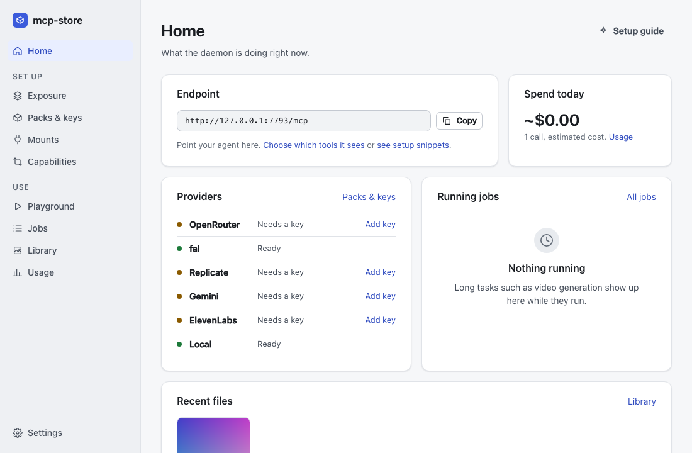
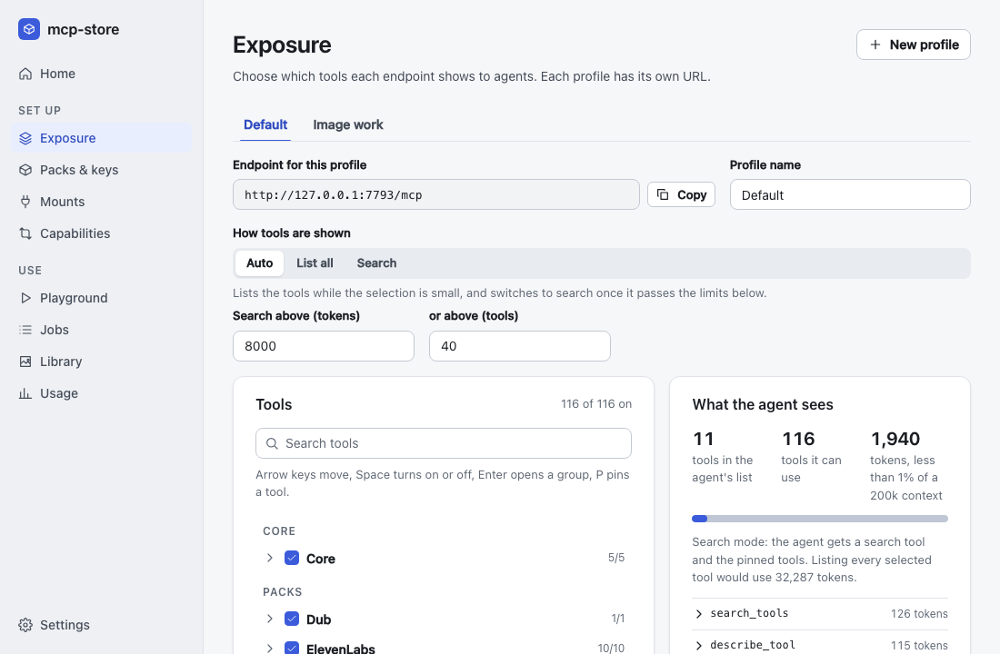
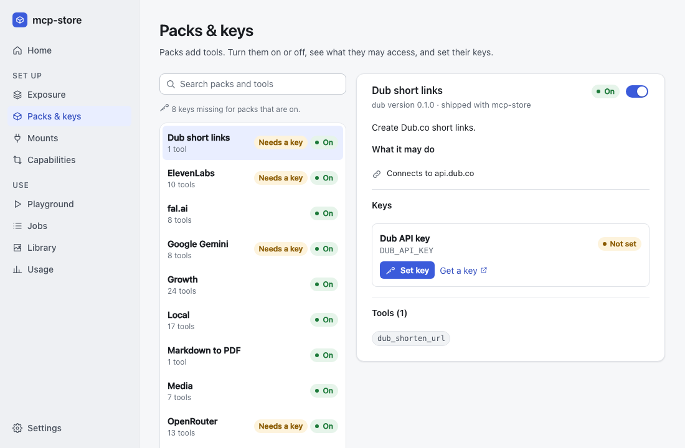
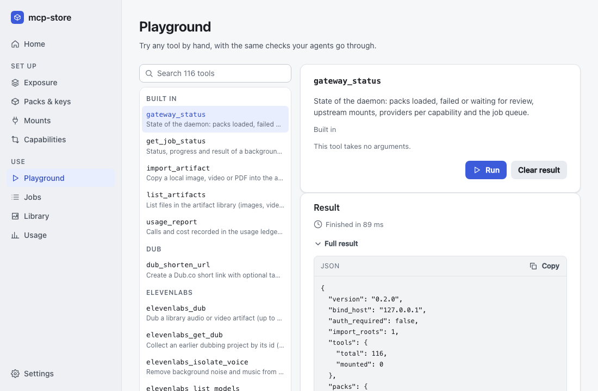

# plughive

plughive is a daemon that runs on your machine and gives your AI agents one
MCP endpoint for image, video, speech, music, web and other tools. You bring
your own provider keys; nothing goes through a hosted service.

It serves 36 bundled packs with 173 tools on by default (193 with the
off-by-default machines, sandbox and cli-bridge packs) over MCP Streamable HTTP at
`http://127.0.0.1:7777/mcp`, plus a dashboard for keys, packs and results.

## Quickstart

You need Node.js 22 or later. Pick one way to run it.

**npx** (after the package is published to npm):

```sh
npx plughive
```

**Docker**, in a checkout of this repository (state in a volume, access key
required). Compose reads three
values from a `.env` file next to `docker-compose.yml`; this creates one if
there is none:

```sh
[ -e .env ] || printf 'PLUGHIVE_ACCESS_KEY=%s\nPLUGHIVE_ADMIN_TOKEN=%s\nPLUGHIVE_SECRETS_PASSPHRASE=%s\n' \
  "$(openssl rand -hex 32)" "$(openssl rand -hex 32)" "$(openssl rand -hex 32)" > .env
docker compose up -d --build
docker compose exec plughive plughive dashboard --print
```

**Desktop app** (macOS, Windows, Linux): a tray app that bundles its own
Node, runs the daemon and opens the dashboard. Not signed for distribution
yet. See [app/README.md](app/README.md).

**From source**:

```sh
git clone <repository-url> plughive
cd plughive
pnpm install --frozen-lockfile
pnpm build
node dist/src/cli.js start
```

The daemon prints `plughive on http://127.0.0.1:7777` and a dashboard
sign-in link. Check that it answers with a tool call. This one needs no key:

```sh
curl -s http://127.0.0.1:7777/mcp \
  -H 'content-type: application/json' \
  -H 'accept: application/json, text/event-stream' \
  -H 'mcp-protocol-version: 2025-06-18' \
  -d '{"jsonrpc":"2.0","id":1,"method":"tools/call","params":{"name":"search_tools","arguments":{"query":"image"}}}'
```

The answer is an SSE `message` event whose text starts with
`{"ok":true,"result":{"tools":[...`. With Docker, add
`-H "Authorization: Bearer $PLUGHIVE_ACCESS_KEY"` (the value from your
`.env`).

**Keep it running at login** (macOS, Linux and Windows): with the CLI
installed or built, `plughive service install` registers the daemon with
the computer's own service manager (a LaunchAgent, a systemd `--user` unit,
or a Task Scheduler logon task). `plughive service status` checks it, and
`plughive service uninstall` removes it. Skip this if you use the desktop
app, which already runs the daemon.

Next: open the dashboard (`plughive dashboard`), paste a provider key under
Packs & keys, and connect a client. [docs/getting-started.md](docs/getting-started.md)
walks through it.

## Connect a client

The endpoint is `http://127.0.0.1:7777/mcp`. Each profile also has its own
endpoint at `/p/<profile>/mcp` (see [Profiles](docs/profiles-and-exposure.md)).
If you set `PLUGHIVE_ACCESS_KEY`, every client must send
`Authorization: Bearer <key>`. The snippets below read the key from the
`PLUGHIVE_ACCESS_KEY` environment variable so it does not land in a config
file. Leave the header out when no key is set.

The quickest way is to let the CLI (or the desktop app's "Connect a client" menu)
write the entry for you. It changes only its own entry, backs the file up
once, and leaves a file it cannot parse alone:

```bash
plughive clients
```

```bash
plughive connect claude-code
```

Clients: `claude-desktop`, `claude-code`, `cursor`, `codex`, `hermes`. Add
`--dry-run` to see the file first, `--profile <id>` for a profile endpoint,
`--remove` to undo. To write a client's config by hand, use the snippets below.

### Cursor

Open this link to add the daemon (no access key):

```
cursor://anysphere.cursor-deeplink/mcp/install?name=plughive&config=eyJ1cmwiOiJodHRwOi8vMTI3LjAuMC4xOjc3NzcvbWNwIn0%3D
```

`plughive cursor-link` prints the same link.
`plughive cursor-link --access-key-env PLUGHIVE_ACCESS_KEY` prints one that
sends the key from your environment. `--url` changes the endpoint, for example
to a profile. Or add it to `~/.cursor/mcp.json` by hand:

```json
{
  "mcpServers": {
    "plughive": {
      "url": "http://127.0.0.1:7777/mcp",
      "headers": { "Authorization": "Bearer ${env:PLUGHIVE_ACCESS_KEY}" }
    }
  }
}
```

### Claude Code

```sh
claude mcp add --transport http plughive http://127.0.0.1:7777/mcp \
  --header "Authorization: Bearer $PLUGHIVE_ACCESS_KEY"
```

Or install the plugin in this repo, which also adds a skill that explains the
tools:

```sh
claude plugin marketplace add ./plugin
claude plugin install plughive@plughive-local
```

The plugin reads `PLUGHIVE_URL` (default `http://127.0.0.1:7777`) and
`PLUGHIVE_ACCESS_KEY` from the environment. See [plugin/README.md](plugin/README.md).

### Codex

```sh
codex mcp add plughive --url http://127.0.0.1:7777/mcp \
  --bearer-token-env-var PLUGHIVE_ACCESS_KEY
```

Or in `~/.codex/config.toml`:

```toml
[mcp_servers.plughive]
url = "http://127.0.0.1:7777/mcp"
bearer_token_env_var = "PLUGHIVE_ACCESS_KEY"
```

### Hermes

In `~/.hermes/config.yaml`:

```yaml
mcp_servers:
  plughive:
    url: "http://127.0.0.1:7777/mcp"
    headers:
      Authorization: "Bearer <your access key>"
```

`hermes mcp add plughive --url http://127.0.0.1:7777/mcp` adds the same
entry from the command line.

### Claude Desktop

Claude Desktop starts local servers as commands, so it reaches an HTTP
endpoint through the `mcp-remote` bridge from npm. `plughive connect
claude-desktop` writes this entry for you. By hand, in
`claude_desktop_config.json`:

```json
{
  "mcpServers": {
    "plughive": {
      "command": "npx",
      "args": [
        "-y", "mcp-remote@0.16.7", "http://127.0.0.1:7777/mcp",
        "--transport", "http-only",
        "--header", "Authorization:${AUTH_HEADER}"
      ],
      "env": { "AUTH_HEADER": "Bearer <your access key>" }
    }
  }
}
```

`mcp-remote` is a third-party package that receives your access key. Keep
the exact version pin (`mcp-remote@0.16.7`, the version plughive writes) so
`npx` never fetches a newer release on its own, and keep the file readable by
you only (`chmod 600`; plughive's own writes do this). Shipping a bundled
bridge, so that no npm download is involved, is future work.

## What you get per key

Every pack loads without its key. Its tools answer with a missing-key error
until you save the key in the dashboard. The full list is in
[docs/packs.md](docs/packs.md).

| Key | Pack | What it adds |
| --- | --- | --- |
| none | local | ffmpeg media tools and video upscaling, speech to text (parakeet-mlx, Hex, whisper.cpp or whisperX), Ollama chat, translation, embeddings and reranking, Kokoro speech, ComfyUI image generation and editing, Real-ESRGAN, rembg, Demucs, pdftotext, Tesseract, OCRmyPDF, pandoc, LibreOffice and yt-dlp transcripts (each when installed) |
| `HF_TOKEN` (optional) | local | Speaker labels in local transcription through whisperX (`transcribe_audio` with `speakers: true`) |
| none | pdf | Markdown to PDF with pandoc (when installed) |
| none (off by default) | cli-bridge | Ask the agent CLIs you have signed in (claude, codex, gemini, agy, opencode, copilot) a question; agy images into the library |
| none | media, workflows | Provider-neutral `generate_image`, `generate_video`, `generate_speech`, ... and 7 multi-step workflows, using whatever providers you set up |
| none | memory | Long-term semantic memory (`remember`, `recall`, `forget`) stored locally in SQLite, using whichever `text.embed` provider you set up |
| `OPENROUTER_API_KEY` | openrouter | Chat with any OpenRouter model; image, video and speech models |
| `FAL_KEY` | fal | Search and run fal.ai models |
| `REPLICATE_API_TOKEN` | replicate | Search and run Replicate models |
| `GEMINI_API_KEY` | gemini | Gemini images, video, speech, music, transcription and chat |
| `ELEVENLABS_API_KEY` | elevenlabs | Speech, sound effects, music, dubbing, transcription, voice isolation |
| `FIRECRAWL_API_KEY` | web | Scrape, search, map and crawl the web (`screenshot_url` needs no key) |
| `APOLLO_API_KEY` | growth | Lead search and enrichment through Apollo |
| `DUB_API_KEY` | dub | Short links |
| `DATAFORSEO_LOGIN`, `DATAFORSEO_PASSWORD` | seo | SERP, keyword volume, backlinks, on-page audits |
| `TELEGRAM_BOT_TOKEN` | telegram | Send messages and files through a bot |
| `RESEND_API_KEY` | email | Send email through Resend |
| `AGENTMAIL_API_KEY` | email | List, read and reply in AgentMail inboxes |
| `TWILIO_ACCOUNT_SID`, `TWILIO_AUTH_TOKEN` | phone | Send and list SMS through Twilio |
| `VAPI_API_KEY` | phone | Start and check outbound Vapi voice calls |
| `BROWSERBASE_API_KEY` | browser | Browserbase sessions and page fetch |
| `STEEL_API_KEY` | browser | Steel sessions, navigate, screenshots into the library |
| `AYRSHARE_API_KEY` (`AYRSHARE_PROFILE_KEY` optional) | social | Post, delete and list social posts through Ayrshare |
| `PEXELS_API_KEY`, `UNSPLASH_ACCESS_KEY`, `FREESOUND_API_KEY` | stock | Search and download stock photos, videos and sounds with attribution |
| `GOOGLE_MAPS_API_KEY` | maps | Geocode, places search and routes |
| `MAPBOX_ACCESS_TOKEN` | maps | Geocode and directions |
| `POLYGON_API_KEY`, `ALPHAVANTAGE_API_KEY` | finance-data | Read-only quotes and price bars (no trading) |
| `SHARE_S3_ACCESS_KEY_ID`, `SHARE_S3_SECRET_ACCESS_KEY` | share | Expiring public links to library artifacts on R2 or S3 |
| `CALCOM_API_KEY` | calendar | Cal.com event types, free slots, booking create and cancel |
| `E2B_API_KEY`, `DAYTONA_API_KEY` | sandbox (off by default) | Cloud sandboxes for running code; local `docker_run` needs no key |
| `EXA_API_KEY` | exa | Web search through Exa (`search_web`) |
| `TAVILY_API_KEY` | tavily | Web search through Tavily (`search_web`) |
| `BRAVE_API_KEY` | brave | Web search through Brave Search (`search_web`) |
| `PARALLEL_API_KEY` | parallel | Web search through Parallel (`search_web`) |
| `JINA_API_KEY` | jina | Read a web page as markdown or text with Jina Reader (`fetch_web`) |
| `MISTRAL_API_KEY` | mistral | Document and image OCR to markdown with Mistral OCR (`parse_document`) |
| `DEEPL_API_KEY` | deepl | Translation with DeepL, Free or Pro key (`translate_text`) |
| `SUPADATA_API_KEY` | supadata | Transcripts of YouTube, TikTok, Instagram, X and video-file URLs (`get_media_transcript`) |

The `mounts` pack lists remote MCP servers (Exa, Tavily, Linear and others)
that stay off until you switch one on and give it its key. Servers that sign
in with OAuth (Notion, Sentry, Linear, Atlassian, Stripe, Cloudflare) and app
gateways (Zapier, Pipedream, Composio) have a Connect button on the Mounts
page instead: you sign in on the vendor's site and the tokens stay in the
secret store.

## Dashboard

`plughive dashboard` opens it, signed in. `plughive dashboard --print`
prints the link instead.









It also has pages for mounts, capability routing, the artifact library, jobs,
triggers, usage and settings.

## Security model

1. The daemon binds `127.0.0.1` and refuses any other address unless `PLUGHIVE_ACCESS_KEY` is set.
2. The dashboard and `/api` always need the admin token, kept owner-only in the home folder.
3. Provider keys go to the OS keyring (macOS Keychain, Windows Credential Manager, the Linux Secret Service) or an owner-only file, optionally encrypted, and never to logs or tool results.
4. Packs you add stay off until you review what they ask for and enable them; their code runs in the daemon with your rights, so only add packs you trust.
5. Outbound requests go through a guard that blocks private and metadata addresses, and there is no telemetry.

Details and limits: [docs/security.md](docs/security.md) and [SECURITY.md](SECURITY.md).

## Extend it

- Write a pack: a folder with `pack.json` and a JavaScript entry. Start from
  [examples/hello-pack](examples/hello-pack) and
  [docs/writing-a-pack.md](docs/writing-a-pack.md). Install it with
  `plughive pack add <folder>`.
- Write a workflow: a JSON recipe that chains tools. See
  [docs/workflows.md](docs/workflows.md).
- Mount a remote MCP server from the dashboard under Mounts, with a key or
  by signing in (Connect).
- Or ask your agent ("add me an MCP server for GitHub"): `list_mounts`,
  `enable_mount` and `connect_mount` set up what the catalog offers, and
  `add_mount` proposes any other http or stdio server, which is added once
  you approve it on the Approvals page. See
  [docs/security.md](docs/security.md#mounts-an-agent-proposes).
- Smart mount keeps unused servers from costing tokens: it parks idle,
  costly and duplicate mounted servers, hides from each profile what that
  profile never calls, moves costly profiles to search, and flags mounts that
  need a sign-in or a key or keep failing. Parked tools stay findable and come
  back when an agent asks for one, and every change can be undone. See the
  Mounts page, `optimize_mounts`, and
  [docs/profiles-and-exposure.md](docs/profiles-and-exposure.md#smart-mount).
- Run a workflow on a schedule or from a signed webhook, and be told when it
  ends: see [docs/triggers.md](docs/triggers.md) and the Triggers page.
- Run one tool over many inputs as one job with `batch_run`, or chain calls
  in a script with `run_tool_script` (off unless `PLUGHIVE_CODE_MODE=1`).
- Library files are MCP resources (`artifact://<id>`) and workflows are MCP
  prompts, for clients that show them.

## Limits

- Every call to a paid provider (OpenRouter, fal, Replicate, Gemini,
  ElevenLabs, Firecrawl, Apollo, Dub, DataForSEO, Telegram) is tested against
  mocks only. None runs against the real API in the test suite. Expect
  mismatches with live APIs and report them.
- One user per daemon. There are no accounts, quotas or tenants.
- Cost figures in the usage page are estimates.
- The desktop app is not signed for distribution: ad-hoc on macOS (not
  notarized), unsigned on Windows. Each OS's app is built on that OS.
- MCP resources are library files and MCP prompts are workflows; there are
  no other resources or prompts, and no resource subscriptions.
- Triggers run inside the daemon: nothing is scheduled while it is stopped,
  and runs and callbacks are never retried.

## Documentation

- [Getting started](docs/getting-started.md)
- [Configuration](docs/configuration.md): every environment variable
- [Bundled packs](docs/packs.md)
- [Writing a pack](docs/writing-a-pack.md)
- [Workflows](docs/workflows.md)
- [Triggers](docs/triggers.md): schedules and webhooks
- [Installing software](docs/software.md): ffmpeg, whisper.cpp and its models, and the rest of the catalog
- [Profiles and exposure](docs/profiles-and-exposure.md)
- [Languages](docs/i18n.md): choosing one, and adding a translation
- [Protocol](docs/protocol.md)
- [Security](docs/security.md)
- [Architecture](docs/architecture.md)
- [Live testing](docs/live-testing.md)
- [Contributing](CONTRIBUTING.md) and [changelog](CHANGELOG.md)

## License

Apache-2.0. See [LICENSE](LICENSE) and [NOTICE](NOTICE).
